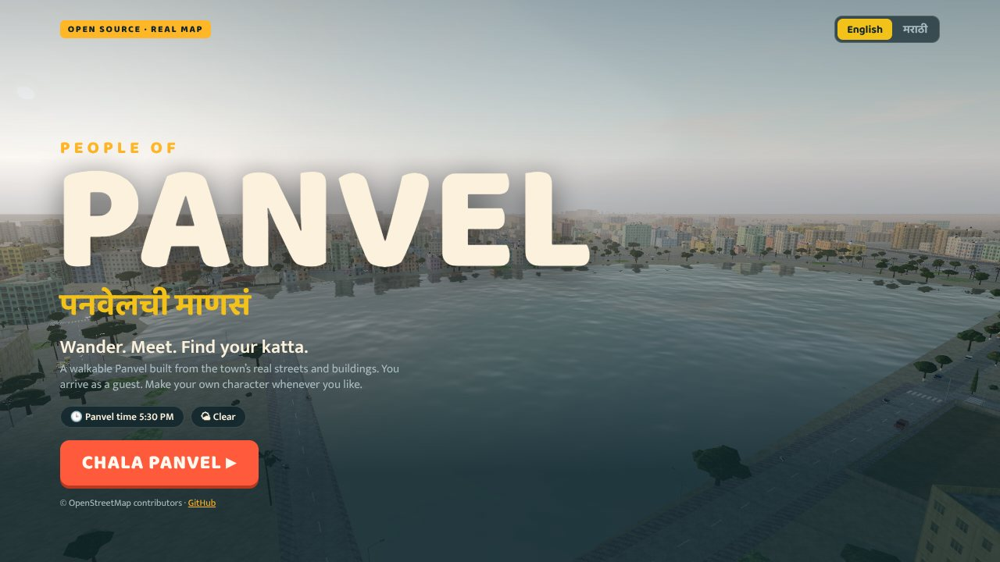
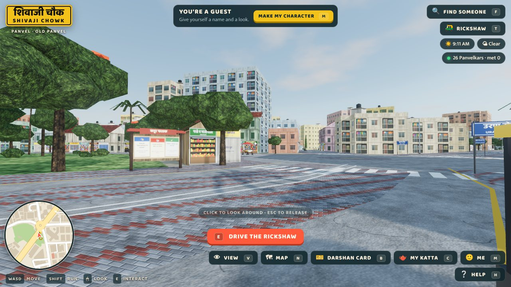
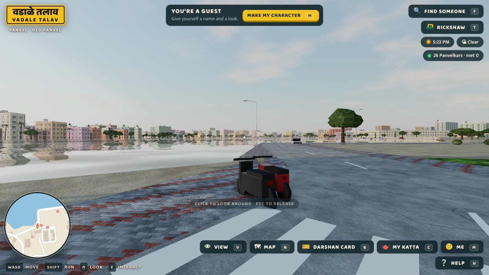
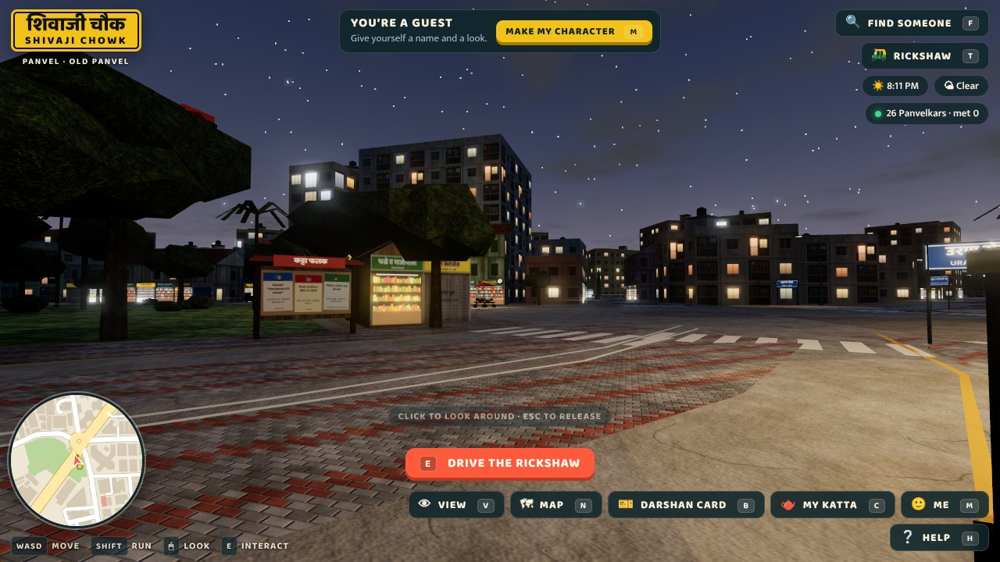
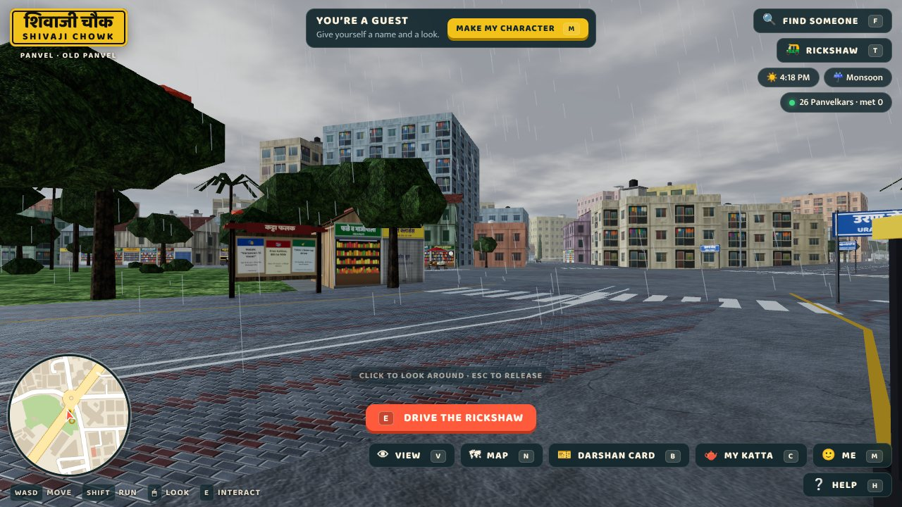
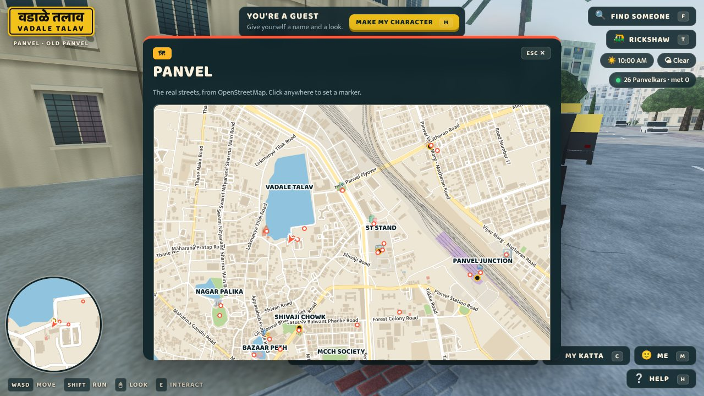

# People of Panvel · पनवेलची माणसं

Walk through a 3D Panvel built from the town's real streets and buildings, and meet the people who make it what it is.

It runs entirely in the browser. There is no build step, no server and no account.



| | |
| --- | --- |
|  |  |
|  |  |



## What's in it

- **The real town.** About 4,600 building footprints, the full street network, Vadale Talav and the other lakes, the river, the flyover, the rail lines and the platforms of Panvel Junction, all taken from OpenStreetMap and placed where they really are.
- **Real names.** Street nameboards, signboards on hospitals, banks, schools and shops that the map records, housing-society name plates, and a live map with street names.
- **Walking pace.** First-person view by default, at a real walking speed, with footsteps and street sound. Press `V` for a view from behind.
- **Residents.** 26 characters with profiles in English and Marathi. They are fictional (see below).
- **Meet other visitors.** Go live and other people on the site see your character walking around. Talk to those nearby, to the whole town, or privately with one person. See [Going live](#going-live).
- **A town that moves.** Traffic keeps left, scooters weave, a local pulls in and out of Panvel Junction, evening walkers circle the lake, and cows rest where they please.
- **Things to do.** Collect Panvel Darshan stamps at 16 landmarks, drive a rickshaw, sit for a cutting chai, read and pin notices, take a stray along, and hop between neighbourhoods by share rickshaw.
- **Things to do together.** Wave, clap, dance or fold your hands in a namaskar. Hop into another visitor's rickshaw. Sit at the same tea stall and you share a katta of your own. Follow a friend, or send a "meet me here" pin. See [Doing things together](#doing-things-together).
- **Street games.** A timed lap of Vadale Talav, and eight golden modaks hidden around town that move every day. See [Street games](#street-games).
- **Satellite ground, if you want it.** Add a free imagery key and the ground and rooftops are drawn from aerial photos. See [Satellite imagery](#satellite-imagery).
- **Weather and time.** The sun follows the real solar path for Panvel at the current time in India. The monsoon months bring rain, wet streets and low cloud. Both can be changed from the HUD.

## Run it

Any static file server works. From the repository root:

```sh
python3 -m http.server 8000
```

Then open <http://localhost:8000>. Opening `index.html` straight from disk will not work, because browsers block module and data loading from `file://`.

The live site is <https://peopleofpanvel.com>. The `CNAME` file ties that domain to GitHub Pages, which serves the repository root as it is.

Before publishing a change, run `node tools/stamp.mjs`. It gives every script and the stylesheet a new version number in `index.html`, so a browser holding yesterday's files never mixes them with today's.

## Controls

| Key | Action |
| --- | --- |
| `W` `A` `S` `D` | Walk |
| `Shift` | Jog |
| Mouse | Look around (click once to capture the mouse, `Esc` to release) |
| `E` | Interact |
| `V` | First person / third person |
| `N` | Map |
| `F` | Find someone |
| `T` | Share rickshaw |
| `B` | Darshan card |
| `C` | My katta |
| `M` | My character |
| `1` to `5` | Gestures: namaskar, wave, clap, dance, laugh |
| `P` | Street games |
| `H` | Help and settings |

On a phone, the left thumb walks and the right thumb looks.

Set a marker (from the map, Find someone, a Darshan stamp or a game) and the chip at the top of the screen offers **Walk me**: your character walks there along the streets. Touch the controls to take over.

## Graphics

Three tiers are available under Help: low, medium and high. High adds ambient occlusion and mirror reflections on the lakes and needs a dedicated graphics card. The game picks a tier on first load and steps effects down by itself if the frame rate stays low.

## Going live

The site has no server of its own. When a visitor chooses **Go live**, their browser joins a public MQTT relay and exchanges small messages with other visitors' browsers. Until then, nothing leaves the browser.

What that means in practice:

- Other visitors see your character, the name and status line you typed, and where you are walking.
- **Nearby** chat carries about 60 metres. **All Panvel** reaches everyone online. Both are public and pass through the relay in the clear, like talking in the chowk.
- **Private** chats open only when both people agree, and are encrypted end to end (ECDH P-256 and AES-GCM), so the relay carries only ciphertext.
- Nothing is stored anywhere. Close the tab and you, and your messages, are gone.
- Names are not verified, and there is no moderator. Incoming text is filtered for abuse, links and phone numbers, floods are rate-limited, and anyone can block anyone. Reports open a GitHub issue.

The relays are free public test brokers (`broker.emqx.io`, with `broker.hivemq.com` as a fallback), set in `js/net/live.js`. They come with no guarantee of uptime. For a busier or better-moderated town, replace them with your own broker or a hosted service: the game only needs the handful of methods on the `Live` class.

| Key | Action |
| --- | --- |
| `L` | Go live |
| `Enter` | Open chat |
| `E` near a visitor | Wave, follow, ask for a private chat, block, report |
| `E` near a visitor's rickshaw | Hop in |

### Doing things together

All of this needs both people to be live.

- **Gestures.** Keys `1` to `5`, or the gestures button. People within about 60 metres see them. Residents answer back.
- **Shared rides.** When a visitor is sitting in a rickshaw, walk up and press `E` to hop in. You ride in the back seat wherever they drive. The ride ends when either of you gets out.
- **Katta circles.** Sit at a tea stall or on a bench and you join the circle for that spot. What you say there goes only to the people sitting with you, and anyone in the circle can order a cutting for everyone. Circle talk passes through the relay in the clear, like nearby chat.
- **Follow.** From a visitor's card, your character walks after them until you touch the controls.
- **Meet me here.** The pin button in chat sends your spot with your message. The other person taps it and gets a marker to walk to.

## Street games

Open them with `P` or the dice button. Both work without going live.

- **Talav race.** One lap of Vadale Talav on foot, about 1.3 km, through ten checkpoints. It starts under the banner on the south bank, next to the rickshaw stand. Your best time is kept in your browser. If you are live, finished laps are announced to the town and listed for the session.
- **Modak hunt.** Eight golden modaks stand by the roadside under a shaft of light. Their places are picked from the date in India, so everyone hunts the same eight on the same day, and they move at midnight. The games panel gives a hint that lands within about 40 metres.

Times are reported by each browser and are not verified.

## Satellite imagery

By default the ground is painted by the game. With an imagery key, the ground and the flat rooftops are drawn from aerial photographs instead, and from high up in the third-person view (scroll out) the town looks like a satellite map with buildings standing on it.

1. Create a free account at [location.arcgis.com](https://location.arcgis.com/) (ArcGIS Location Platform).
2. Create an API key with the **Location services > Basemaps** privilege. Under referrers, allow only your own site address.
3. Paste the key between the quotes after `key:` in `js/config.js`.

The free tier covers two million map tiles a month. A visit uses a few hundred. The key is visible to anyone who views the page source, which is why the referrer restriction matters. Imagery © Esri and its data providers, credited on screen.

## The residents are fictional

Every named resident in `js/data/people.js` is a composite written for this project. None of them is a portrait of a real person. Live visitors are marked with a green dot on their name plate.

To add a real Panvelkar, with their consent:

1. Make your character in the game (`M`), then use **Add me to Panvel for real**. This opens a GitHub issue containing your character card.
2. Or add an entry to `js/data/people.js` in a pull request. Each entry has a name, a role, a spot on the map, a look, a status line, a short story and a few things they say, in English and Marathi.

Please do not add anyone without their permission.

## The map data

`data/panvel.json` is generated from OpenStreetMap by `tools/build-map.mjs`.

```sh
node tools/build-map.mjs --fetch   # download fresh extracts, needs network
node tools/build-map.mjs           # rebuild data/panvel.json from the cache
```

The script projects the data to metres around the ST depot, splits streets into a graph, guesses building heights where the map has none, and marks which walls face a street. If a building, street or name is wrong in the game, the best fix is usually to correct it on [OpenStreetMap](https://www.openstreetmap.org/) and regenerate.

Landmark facts live in `js/data/places.js`. Corrections are welcome.

## Not built yet

- Kharghar and Karnala, which appear in the rickshaw menu as coming soon.
- Anything that needs a server: accounts, verified identities, moderation tools, leaderboards that last, and chat or notice boards that persist after people leave.

## Project layout

```
index.html            page shell
css/style.css         interface styles
data/panvel.json      generated map
tools/build-map.mjs   OpenStreetMap converter
tools/stamp.mjs       stamps a release so browsers never mix old and new files
js/main.js            game loop
js/config.js          the one setting a site owner may want to change (imagery key)
js/games.js           Talav race and the daily modak hunt
js/gfx/               renderer, sky, procedural textures and materials
js/world/             town builder: streets, rail, buildings, props, landmarks, names
js/entities/          player, camera, residents, crowd, traffic, live visitors
js/net/               going live: relay client, presence, chat, input safety
js/data/              residents, places, street names
js/ui.js              interface
vendor/               three.js r170 and the add-ons used (MIT)
```

## Credits and licence

- Map data © [OpenStreetMap](https://www.openstreetmap.org/copyright) contributors, available under the Open Database Licence. `data/panvel.json` is a derived database and is shared under the same licence.
- [three.js](https://threejs.org/) is used under the MIT licence.
- Fonts: Baloo 2 and Mukta, from Google Fonts, under the SIL Open Font Licence.
- The code and writing in this repository are released under the MIT licence. See `LICENSE`.
